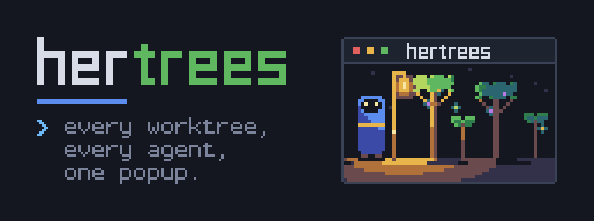
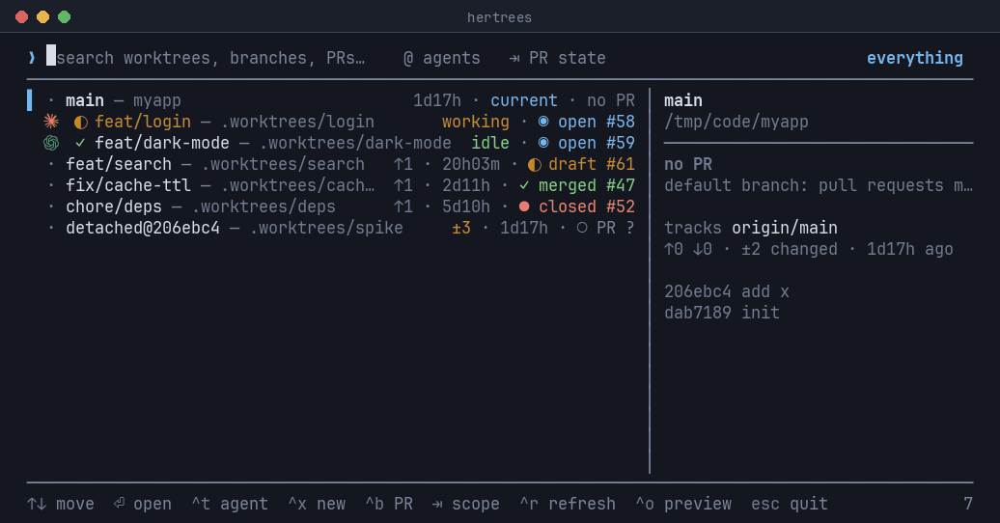

<p align="center">
  
</p>

# Hertrees

A [Herdr](https://herdr.dev) plugin: every git worktree of the project you are in, in one
popup, with its pull request state, the agents running in it, and a key to start a new
agent session there or in a brand-new worktree. It is a single self-contained binary:
it needs only Herdr, `git` and, for pull request state, an authenticated `gh`.

<p align="center"></p>

- **Any project.** The popup shows the repository of the pane you opened it from, even
  from inside a linked worktree. Nothing to configure per repo.
- **PR state per worktree:** `✓ merged`, `◉ open`, `◐ draft`, `● closed`, `no PR`, or
  `○ PR ?` with the reason (gh missing, not logged in, offline, non-GitHub remote,
  detached HEAD). It never claims "no PR" when it could not check.
  Branches are matched by name and owner (fork PRs with the same branch name are ignored);
  a branch whose upstream has another name is matched through the upstream.
- **Links.** The `#N` chip is an OSC 8 hyperlink and a click target; `^b` opens the
  selected PR in the browser. The preview shows the PR title and URL.
- **Agents.** The left glyph is herdr's status of the agents running in that checkout
  (`◉` needs you, `◐` working, `●` done, `✓` idle); the preview lists them.
- **New sessions.** `^t` starts an agent in the selected worktree (a new tab if its
  workspace is already open); `^x` makes a new worktree from the default branch and starts
  an agent (or just a shell) in it. Pick the agent, then `⇥` a preset first prompt:
  `blank`, your saved templates (initially `plan` and `research`), or `custom`. Manage
  templates with `^e`; save a custom prompt with `^s`. If the agent stops at a startup
  question (Claude's folder-trust prompt), the prompt waits until you answer it.
- **Local facts:** dirty files `±N`, ahead/behind `↑↓`, last commit age, recent commits.

## Install

Needs Herdr 0.9.3+, `git`, and `gh` (logged in) for PR state. Installing builds from source,
so it also needs Rust 1.88+ (install with [rustup](https://rustup.rs)).

```bash
herdr plugin install janooh37-hue/hertrees  # from GitHub, builds with cargo
# or, from a local checkout:
sh scripts/install.sh && herdr plugin link /path/to/hertrees
```

Herdr never adds keybindings itself. In `~/.config/herdr/config.toml`:

```toml
[keys]
workspace_picker = ""          # only if you take prefix+w from herdr's workspace picker

[[keys.command]]
key = "prefix+w"
type = "plugin_action"
command = "hertrees.open"
description = "worktrees"
```

then `herdr server reload-config`.

## Keys

| Key | Action |
|---|---|
| type | fuzzy search: branch, path, `#123`, PR title, PR state, agent |
| `↑↓` `^p` `^n` `^k` `^j` `PgUp` `PgDn` | move |
| `⏎` / click selected row | focus the worktree's workspace, opening it if needed |
| `^t` | new agent session in the selected worktree |
| `^x` | new worktree: branch name → agent (or shell) → preset |
| `^b` / click `#N` | open the PR in the browser |
| `⇥` `⇧⇥` | scope: everything → no PR → open → draft → merged → closed → agents |
| `@` (empty query) | agents scope |
| `^r` | reload worktrees and agents, re-fetch PRs |
| `^o` | toggle the preview column |
| `^u` `^w` `^a` `^e` `^d` | clear, delete word, home, end, delete forward |
| `esc` | back / close |

In the agent picker: type to filter, `⇥` cycles the preset, `⏎` starts, `^e` manages
presets. In the preset manager: type to filter, `⏎` edits, `^x` creates, `^r` renames,
`⌦` / `^d` deletes (confirm with `⏎`), `esc` goes back. In the Custom prompt editor,
`^s` saves the prompt as a named preset and returns to the agent picker.

## Configuration

`~/.config/herdr/plugins/config/hertrees/config.json` (every key optional; see
[agent docs](docs/agents.md#configuration) for config-directory overrides and all keys):

```json
{
  "agents": ["claude", "codex", "omp"],
  "default_agent": "claude",
  "pr_cache_ttl_s": 60,
  "scope": "all",
  "preview": "auto",
  "mouse": true,
  "agent_icons": "auto",
  "refresh_ms": 900,
  "selection_background": "auto",
  "colors": { "pr_merged": "bright_green", "pr_open": "bright_blue", "pr_draft": "#c78a1f", "pr_closed": "bright_red" }
}
```

- `agents`: kinds offered, in order. Default: every Herdr-supported agent found on `PATH`.
- Presets are plain Markdown files at `<config_dir>/presets/<name>.md`, not JSON
  configuration. `plan.md` and `research.md` are seeded only when that directory does
  not exist; edit, rename or delete them freely. `blank` and `custom` remain built-in.
  Placeholders: `{branch}` `{base}` `{path}` `{repo}` `{pr}`.
- The preset manager opens `$VISUAL`, then `$EDITOR`, otherwise `nvim` or `vi`.
- `colors` maps role names to a colour: an ANSI name (`red`, `bright_blue`, `gray`, …), a
  0-255 index, a `#rrggbb` hex value, or `default`. Roles: `accent`, `text`, `muted`,
  `match`, the agent states `blocked`, `working`, `done`, `idle`, `unknown`, the PR states
  `pr_open`, `pr_draft`, `pr_merged`, `pr_closed`, and per-agent colours `agent_claude`,
  `agent_codex`, `agent_kimi`, `agent_pi`, `agent_grok`, `agent_gemini`, `agent_cursor`,
  `agent_opencode`.
- Fonts and icons: the default `"agent_icons": "auto"` shows a vendor logo before each
  agent row only when the optional "Herdr Agent Icons Max" font is installed (checked in the
  user font directories and with `fc-match` on Linux). Without it nothing is drawn, only the
  plain Unicode status glyphs. Set `"agent_icons": "none"` to turn the logos off explicitly,
  or `"font"` to force them when the font is installed on a remote terminal.
- PR data is cached in `$XDG_CACHE_HOME/hertrees/` and served stale while it refreshes.

## Command line

```bash
bin/hertrees --list --cwd /path/to/repo      # worktrees, PR state and agents as JSON
bin/hertrees presets                        # preset directory and file templates as JSON
bin/hertrees start --cwd /path/to/repo --path /path/to/checkout --agent claude --preset plan
bin/hertrees start --cwd /path/to/repo --branch feat/cache --base main \
  --agent codex --prompt 'Implement the cache in {path}.' --focus
bin/hertrees start --cwd /path/to/repo --branch scratch --agent shell --focus
bin/hertrees --open                         # open the popup through the Herdr CLI
```

Headless `start` returns the workspace, tab, pane, agent name, checkout path and whether
the first prompt was deferred for startup readiness. It leaves focus unchanged unless
`--focus` is given. See [Using Hertrees from an agent](docs/agents.md) for JSON fields,
prompt delivery, preset files and configuration; `bin/hertrees --help` lists the flags.

## Development

```bash
mise exec -- cargo test --release
sh scripts/install.sh
bash scripts/e2e.sh                         # disposable live Herdr/Claude test
bash scripts/e2e.sh --preset plan           # also submits a real planning request
```

Run the live test inside Herdr with `git`, `jq`, `python3` and authenticated Claude.
It checks worktree creation, tree grouping and the agent's checkout, then cleans up
and restores focus. `--keep` retains artifacts for inspection; `E2E_TIMEOUT` changes
the per-wait timeout (90 seconds by default). See `bash scripts/e2e.sh --help`.

## Credits

Hertrees is made by Ahmed Al Ali. Brand assets and usage notes are in [`branding/`](branding).

The terminal UI layer (painter, input decoder, theme, fuzzy matcher, row layout) started from
herdr-bar by Jeff Arese (MIT, <https://github.com/jeffarese/herdr-bar>, `LICENSE.herdr-bar`).
Hertrees is now an independent project.

## License

MIT, see [LICENSE](LICENSE). Code derived from herdr-bar is under its own MIT licence, see
[LICENSE.herdr-bar](LICENSE.herdr-bar).

<p align="center"></p>
