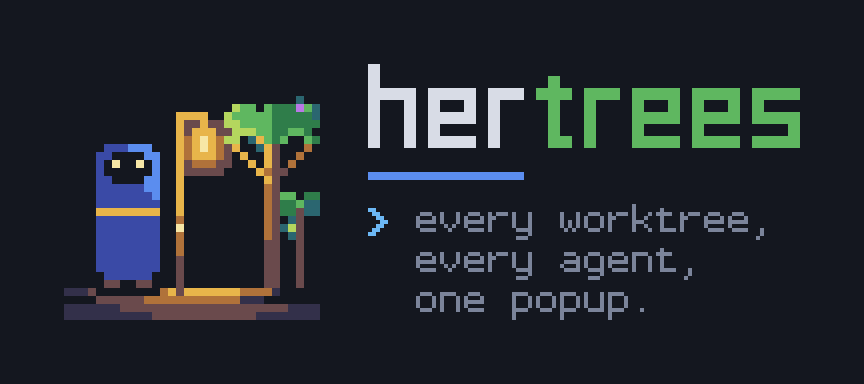

<p align="center">
  <picture>
    <source type="image/svg+xml" srcset="branding/banner/banner.svg">
    
  </picture>
</p>

# Hertrees

A [Herdr](https://herdr.dev) plugin that lists every git worktree of your project in one
popup, with its pull request state and running agents, and starts a new agent session in
any of them or in a brand-new worktree.

<p align="center"></p>

- **Any project:** shows the repository of the pane you opened it from, even inside a linked worktree.
- **PR state per worktree:** `✓ merged`, `◉ open`, `◐ draft`, `● closed`, `no PR`, or `○ PR ?` when it could not check. `#N` is a clickable link.
- **Agents:** the left glyph is Herdr's status for the agents in that checkout (`◉` needs you, `◐` working, `●` done, `✓` idle).
- **New sessions:** start an agent in a worktree, or create a worktree and start one, with a preset first prompt (`blank`, `plan`, `research`, your own, or `custom`).
- **Local facts:** dirty files `±N`, ahead/behind `↑↓`, last commit age, recent commits.

## Quick start

Needs Herdr 0.9.3+ on Linux or macOS, `git`, and an authenticated `gh` for PR state
(optional). Herdr builds the plugin from source on install, so Rust 1.88+ is required
([rustup](https://rustup.rs)).

1. Install:

   ```bash
   herdr plugin install janooh37-hue/hertrees
   ```

2. Bind a key (Herdr adds none) in `~/.config/herdr/config.toml`:

   ```toml
   [[keys.command]]
   key = "prefix+w"
   type = "plugin_action"
   command = "hertrees.open"
   description = "worktrees"
   ```

   `prefix+w` is Herdr's workspace picker by default. This binding takes precedence, but
   to free the key explicitly, add `workspace_picker = ""` to your `[keys]` table (create
   it if the file has none). Then run `herdr server reload-config`.

3. Press `prefix+w` in any pane of a git project.

## Keys

| Key | Action |
|---|---|
| type | fuzzy search: branch, path, `#123`, PR title, PR state, agent |
| `↑↓` `^p` `^n` `^k` `^j` `PgUp` `PgDn` | move |
| `⏎` / click selected row | focus the worktree's workspace, opening it if needed |
| `^t` | new agent session in the selected worktree |
| `^x` | new worktree: branch name → agent (or shell) → preset |
| `^b` / click `#N` | open the PR in the browser |
| `⇥` `⇧⇥` | scope: everything → no PR → open → draft → merged → closed → agents |
| `@` (empty query) | agents scope |
| `^r` / `^o` | reload worktrees, agents and PRs / toggle the preview column |
| `^u` `^w` `^a` `^e` `^d` | clear, delete word, home, end, delete forward |
| `esc` | back / close |

In the agent picker, `⇥` cycles the preset, `⏎` starts and `^e` manages presets (`⏎` edits,
`^x` creates, `^r` renames, `⌦`/`^d` deletes). In the Custom prompt editor, `^s` saves the
prompt as a named preset.

## Configuration

Everything is optional. Edit `~/.config/herdr/plugins/config/hertrees/config.json`:

```json
{
  "agents": ["claude", "codex", "omp"],
  "default_agent": "claude",
  "scope": "all",
  "preview": "auto",
  "colors": { "pr_merged": "bright_green", "pr_draft": "#c78a1f" }
}
```

- `agents`: agent kinds offered, in order. Default: every supported agent found on `PATH`.
- `wordmark`: `"search"` (default, `❯ hertrees │` on the search line), `"pixel"`,
  `"pixel-small"`, `"braille"`, `"sextant"` or `"icon"` (pixel lettering above it), or `"off"`.
- Presets are Markdown files in `<config_dir>/presets/`; `plan.md` and `research.md` are
  seeded on first use. Placeholders: `{branch}` `{base}` `{path}` `{repo}` `{pr}`.
  The preset manager opens `$VISUAL`, then `$EDITOR`, then `nvim` or `vi`.
- Fonts and icons: everything is plain Unicode by default. For vendor logos before agent
  rows, install the optional "Herdr Agent Icons Max" font from
  [herdr-radar](https://github.com/hhdebb/herdr-radar) (not bundled here because its marks
  are third-party trademarks):
  [**download HerdrAgentIconsMax-Regular.ttf**](https://raw.githubusercontent.com/hhdebb/herdr-radar/main/dist/HerdrAgentIconsMax-Regular.ttf).

  ```bash
  # Linux
  mkdir -p ~/.local/share/fonts && curl -fLo ~/.local/share/fonts/HerdrAgentIconsMax-Regular.ttf \
    https://raw.githubusercontent.com/hhdebb/herdr-radar/main/dist/HerdrAgentIconsMax-Regular.ttf && fc-cache -f
  # macOS
  curl -fLo ~/Library/Fonts/HerdrAgentIconsMax-Regular.ttf \
    https://raw.githubusercontent.com/hhdebb/herdr-radar/main/dist/HerdrAgentIconsMax-Regular.ttf
  ```

  Hertrees detects it in your user or system font folder. Set `"agent_icons": "font"` when
  the font is only installed on the machine running your terminal. When Herdr runs on
  another machine (SSH, e.g. Termius on iOS), the font is detected on that server, so
  set `"agent_icons": "off"` if logos show as boxes.

All keys, defaults and colour roles are in [docs/agents.md](docs/agents.md#configuration).

## Command line

```bash
bin/hertrees --list --cwd /path/to/repo   # worktrees, PR state and agents as JSON
bin/hertrees start --cwd /path/to/repo --branch feat/cache --agent claude --preset plan
bin/hertrees --help                       # all flags
bin/hertrees --version                    # version, under the pixel mark on a terminal
```

`bin/` is inside the installed plugin checkout (`plugin_root` in `herdr plugin list --json`).
Scripts and agents can start sessions headlessly; see
[Using Hertrees from an agent](docs/agents.md).

## Development

```bash
mise exec -- cargo test --release
sh scripts/install.sh                     # release build into bin/hertrees
bash scripts/e2e.sh --help                # disposable live Herdr/Claude test
```

See [CONTRIBUTING.md](CONTRIBUTING.md) and [AGENTS.md](AGENTS.md).

## Credits

Made by Ahmed Al Ali. The logo, banner, palette and terminal mark are in
[`branding/`](branding), with a guide to using them. The terminal UI layer
(painter, input decoder, theme, fuzzy matcher, row layout) started from
[herdr-bar](https://github.com/jeffarese/herdr-bar) by Jeff Arese (MIT,
`LICENSE.herdr-bar`). Hertrees is now an independent project.

## License

MIT, see [LICENSE](LICENSE). Code derived from herdr-bar is under its own MIT licence, see
[LICENSE.herdr-bar](LICENSE.herdr-bar).

<p align="center">
  <picture>
    <source media="(prefers-color-scheme: light)" srcset="branding/light/lockup-light.svg">
    
  </picture>
</p>
