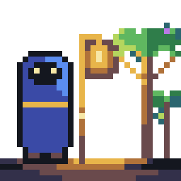
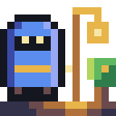
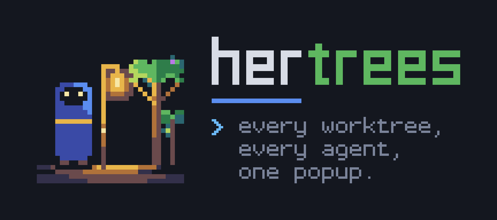
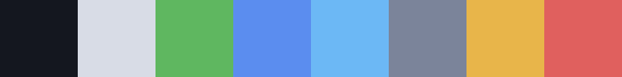

# Hertrees brand

Hertrees is herd + trees: a shepherd tending a grove of git worktrees, with a lantern
lighting the agents at work. The identity is 8-bit pixel art on a dark terminal ground, a
sibling of [Herdr](https://herdr.dev)'s calm, terminal-native look. All artwork is original
to this project; use it to link to or write about Hertrees.

## Logo

| | | |
|---|---|---|
|  |  |  |
| **Mark**: avatars, tiles, large art | **Icon**: 16 to 64 px | **Lockup**: mark, name and tagline |

| File | Use |
|---|---|
| [`logo/mark/`](logo/mark) | 32x32 scene, SVG and 256/512 px PNG |
| [`logo/icon/`](logo/icon) | 16x16 redraw for small sizes (PNG 16 to 512). Do not shrink the mark instead |
| [`logo/wordmark/`](logo/wordmark) | "hertrees" alone, transparent background |
| [`logo/lockup/`](logo/lockup) | mark, wordmark, bar and tagline (dark background) |
| [`light/`](light) | wordmark and lockup for white or light pages |
| [`banner/`](banner) | wide hero image for READMEs and sites |
| [`social/`](social) | 1280x640 GitHub social-preview image |
| [`favicon/`](favicon) | `favicon.ico` (16, 32, 48) |
| [`terminal/`](terminal) | block-character mark for terminals (`mark.txt` plain, `mark.ansi` truecolor) |

## Where each asset is used

| Asset | Used in |
|---|---|
| `banner/` | README header (SVG, PNG fallback); its own dark ground suits light and dark pages |
| `logo/lockup/`, `light/` | README footer: `lockup.svg` on dark themes, `lockup-light.svg` on light |
| `logo/mark/`, `logo/icon/` | avatars and docs (`icon-64.png` heads `docs/agents.md`); a Herdr marketplace icon if it ever takes one |
| `social/social.png` | GitHub Settings → Social preview (uploaded by hand; the repo is public) |
| `favicon/` | any future docs site or GitHub Pages |
| `terminal/mark.ansi` | `hertrees --version` on a terminal; `mark.txt` with `NO_COLOR`. Piped output stays one line |
| `terminal/mark.txt` | `hertrees --version` with `NO_COLOR`; the popup's empty states draw the mark from `src/wordmark.rs::MARK` in brand colours |
| `palette.svg` | this guide. The popup's defaults in `src/theme.rs` are ANSI colours so it follows the terminal's theme; the roles line up (leaf: idle and merged, cloak blue: accent and open, amber: working and draft, red: blocked and closed), and these hex values can be set under `colors` in the config |

## Colour

| Role | Hex | ANSI truecolor |
|---|---|---|
| Ink, background | `#14171f` | `38;2;20;23;31` |
| Text, "her" | `#d8dce6` | `38;2;216;220;230` |
| Leaf, "trees" | `#5fb760` | `38;2;95;183;96` |
| Cloak blue, accent bar | `#5b8def` | `38;2;91;141;239` |
| Prompt blue | `#6cb8f5` | `38;2;108;184;245` |
| Tagline grey | `#7b849a` | `38;2;123;132;154` |
| Lantern amber, "working" | `#e8b54a` | `38;2;232;181;74` |
| Red, closed / window dot | `#e0605e` | `38;2;224;96;94` |

Light backgrounds (`light/`): text `#14171f`, tagline `#566074`, prompt `#2f6fc0`, bar `#3a5fc4`;
leaf unchanged. Status colours match the picker's glyphs.

## Type

The wordmark and tagline are hand-built pixel lettering, so use the supplied files and do
not retype them. The tagline is "every worktree, every agent, one popup." and only appears
with the lockup, banner and social image. For UI and docs use the reader's own monospace font.

## Usage

- Show on ink `#14171f` or on white (use `light/`). Leave clear space of 1/4 of the mark's height.
- Minimum sizes: icon 16 px, mark 64 px, wordmark 108 px wide, lockup 432 px wide.
- Scale by whole numbers only and keep pixels sharp (`image-rendering: pixelated` for PNGs).
- Do not stretch, rotate, outline, shadow, add gradients or transparency, recolour "trees", or
  set the name in another font.
